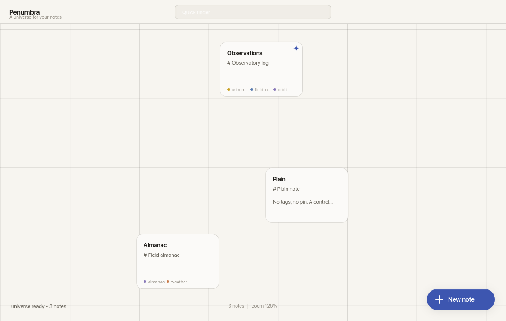
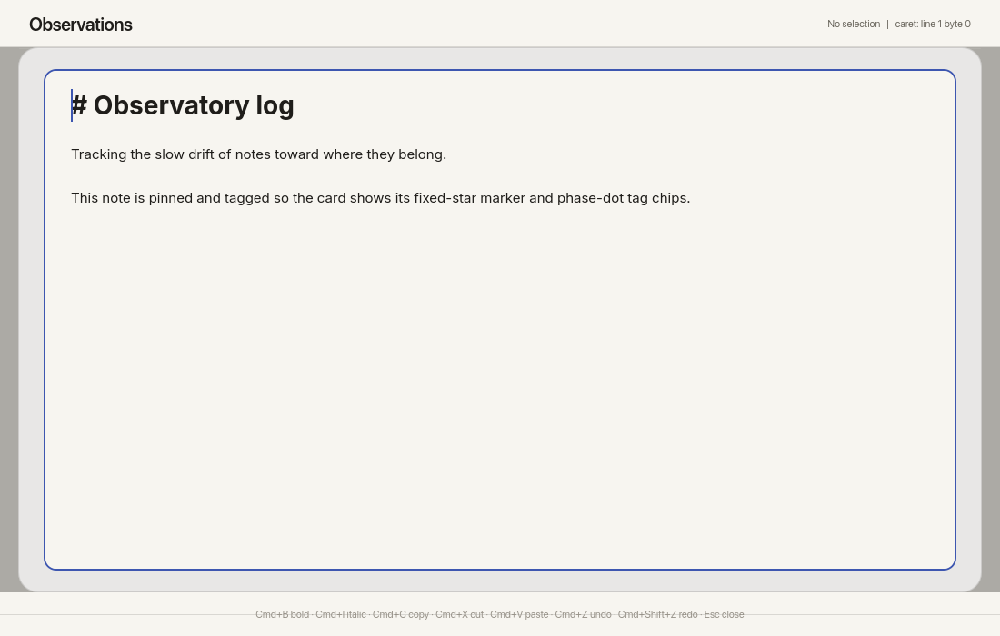

# Penumbra

A notes app where notes live on an infinite canvas instead of in a list, and drift toward the things they're about.

The idea was basically to treat a pile of notes like an astronomer keeps an almanac (not a typo): Precisely recorded, always moving toward where they belong. You're supposed to write in plain Markdown, and then Penumbra reads the meaning, and related notes stay together on the map.
Pin the important ones and they become fixed stars everything else orbits! Pretty cool vision right.

It runs natively (macOS, Linux, Windows) and in the browser as a PWA, from one Rust + [Slint](https://slint.dev) codebase!!!!! Write once, run basically anywhere.

## Screenshots

The map is your whole vault at once. Glass cards sit over a ruled grid, each with a few colored dots for its tags, and faint edges connect notes that ended up near each other.



Opening a note zooms you into the editor. It's WYSIWYG, but it doesn't hide your syntax: the `#` on a heading is still there, just dimmed, because the thing you're editing really is the Markdown underneath. There's no separate rendered copy that can drift out of sync with the source.



## Running it

You need Rust 1.85 or newer. Slint is vendored as a submodule, so clone with `--recursive`:

```sh
git clone --recursive https://github.com/Nisoku/Penumbra.git
cd Penumbra
cargo run -p penumbra-ui
```

The `Justfile` has the usual shortcuts: `just build`, `just check`, `just test`, `just format`, `just clippy`, and `just all` to run everything.

For the browser build you'll want the Wasm target and the `candle-wasm` feature, which bundles the semantic model for the web:

```sh
rustup target add wasm32-unknown-unknown
cargo build --release --target wasm32-unknown-unknown -p penumbra-ui --features candle-wasm
```

After that you run `wasm-bindgen` over the output and serve `index.html` (the CI workflow in `.github/workflows/` has the exact commands). Browsers only load `.wasm` from a trusted context, so serve through a local web server instead of opening the file directly.

## Embeddings

Out of the box Penumbra uses a small hash-based embedder, so it works with nothing to download and ranks on character-trigram overlap. That's fine for a quick start but it isn't semantic. The real model lives behind feature flags: `candle` pulls in the Candle embedder, `candle-load` fetches the weights at runtime on native, and `candle-wasm` does the same for the web build. With it on, search and auto-linking rank on meaning rather than matching characters.

## What's here

The engine is split into small crates under `Build/crates/` by what they own: the note model and storage, the layout solver, the embedder and vector index, search, Markdown parsing, the auto-linker that places notes near their neighbors, and the app layer that ties them together. The Slint front end is in `Build/ui/`, and the tests are in `Build/tests/`. Slint itself lives in `vendor/slint/` as a submodule.

A few things worth knowing about how it behaves. The map culls and drops detail off-screen so it stays responsive with a lot of notes. Editing a note only re-settles its local neighborhood rather than recomputing the whole layout. Cards ease into their new positions with a slight overshoot when you drag, drop, pin, or unpin them, driven by a plain timer in Rust. Layout positions are cached and saved on a throttle, so startup shows the map right away instead of solving it from scratch. There are two themes, a warm paper-colored day one and a dark observatory night one, built to match each other.

Plenty is still unfinished. See `TODO.md` for what's planned, including cloud sync, running inference in a web worker, and an encrypted vault mode.

## License

Penumbra is [Apache-2.0](LICENSE).

The editor bundles two fonts under the SIL Open Font License 1.1, [Inter](https://github.com/rsms/inter) and [JetBrains Mono](https://github.com/JetBrains/JetBrainsMono); their license texts sit next to the font files in `Build/ui/penumbra-ui/assets/fonts/`.
